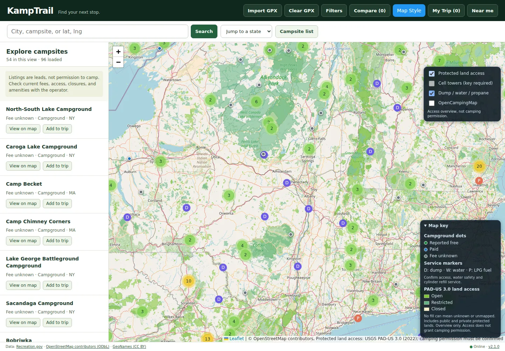
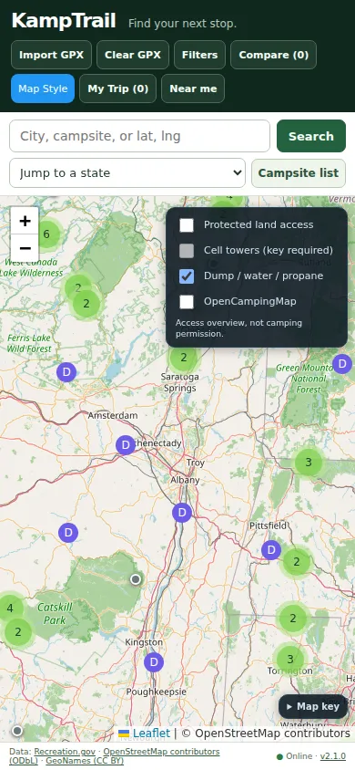

# KampTrail 2.1.0 repair verification

Date: October 27, 2026 (America/New_York)

Baseline: `382915f0b6125f29ed1bbb720c28e9921dc44c89`.

## Problems confirmed

- 1,039 of 3,484 raw merged records had no stable ID. Many popups therefore could not add the selected campsite to a trip or comparison.
- Filter values did not match stored type, amenity, road, or rig values. The existing cleanup module was not called.
- Unknown campsite prices displayed as free. Older importers generated prices, roads, amenities and rig claims from defaults or broad description keywords.
- State fetch failures were marked loaded and could not be retried normally. Initial state loading ran serially and delayed all feature initialization.
- Saved trip stops contained only IDs and disappeared from display/export when the corresponding state was not loaded.
- OpenCampingMap loaded an empty combined file despite available state snapshots.
- Terrain used a retired endpoint. The previous protected-land endpoint returned HTTP 200 with HTML, not an image.
- CDN-only browser libraries prevented the cached shell from starting offline. The old worker deleted every origin cache and could mix stale code with newer HTML.
- Raw and merged source files could overwrite each other during refreshes. Multiple scheduled workflows wrote overlapping datasets.

## Repaired behavior

Source normalization supplies stable IDs and legacy aliases, validates coordinates, aligns filters, and deduplicates overlapping records. Unknowns remain unknown and unsupported historical inferences are hidden. The app loads four state requests at a time, limits request duration, preserves useful saved data, and exposes retry. Controls initialize before source downloads.

Trip and comparison entries retain feature snapshots. GPX parsing accepts namespaces and preserves disconnected track segments. Export refuses to omit unresolved stops silently. Popup HTML and photo attribution URLs are escaped or constructed with safe DOM methods.

The local city index has 7,557 US places. Search also handles loaded campsite names, states, and literal coordinates. The responsive list matches active filters and the map viewport. Browser dependencies ship with the app.

The protected-land layer now uses USGS PAD-US 3.0 Public Access. Its legend distinguishes open, restricted, closed, and unknown/unmapped access and states that it includes public and private protected lands. The layer does not grant camping permission.

One reusable workflow owns refreshes. It uses official RIDB and OSM sources, validates inputs, preserves good sources on fetch failure, rebuilds merged snapshots and the complete index, and serializes repository writes. No source refresh ran during this repair.

## Automated results

- 31 Node tests passed: normalization, filters, source merges, retry, first-visit offline saving, cache validation/isolation, stable identities, safe popup/attribution handling.
- 12 Python tests passed: conservative source extraction, incomplete-response protection, atomic save rules, and workflow structure.
- 12 Chromium tests passed: real committed campsite/city snapshots, city search, filters, add-trip popup, reload in another state, GPX export contents, community state layers, map styles, network recovery, first-visit offline reload, mobile tools, permission denial, project subpath, GPX namespaces, saved comparisons.
- Static release build succeeded. Browser checks ran at desktop 1440×1000 and mobile 390×844, including the `/kamptrail/` project path.

Repeatable browser regressions isolate external imagery. Separate live checks loaded actual provider bytes via the runtime's HTTP proxy: 25 OpenStreetMap tiles and 25 USGS protected-land tiles, all image responses, no provider failures and no JavaScript page errors. Standard, topographic, satellite, and terrain endpoint samples returned real image responses. These are point-in-time checks, not a promise of future provider uptime. Headless Chromium was supplied through `CHROMIUM_PATH`; normal CI installs Chromium with Playwright.

## Scope and remaining limits

This repairs the present KampTrail static app. It does not recreate FreeRoam's accounts, backend reviews, coverage predictions, or downloadable offline basemaps. City search and saved listings work offline. External imagery, photos and directions require internet. No bulk tile download feature is provided.

Historical data is incomplete and uneven. Some RIDB camping-related facilities are not overnight campgrounds, and bounding-box state files include neighboring areas. Original fee/access evidence was lost in some prior imports. Confirm fees, access, closures, road suitability, rig limits, water safety and operational status with the operator. No live field verification is claimed.

Cell towers require a configured provider key and are disabled by default. Code no longer embeds the previous key. Existing credentials in repository history are outside this repair's history-preserving scope.
